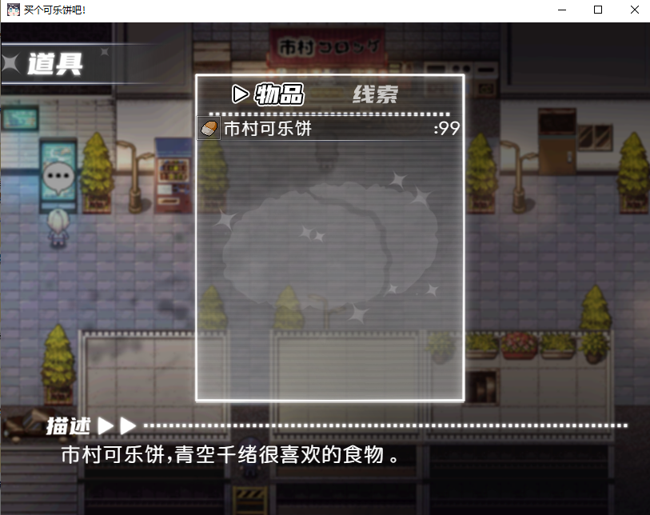

# 买个可乐饼吧！· 无限可乐饼

> **Buy a Croquette — Infinite Croquette Patch**
> 一键给 Steam 正版《买个可乐饼吧！》装上开局资源 + 无限可乐饼外挂。

[](#)
[](#)
[](LICENSE)

---

## 效果

开新档的那一刻，直接拿到：

| 项目 | 数量 |
|---|---|
| 初始资金 | **380 円** |
| 市村可乐饼 | **99 个**（RPG Maker MV 单格上限） |
| 无限模式 | 数量**永不低于 99** |

不修改存档、不注入进程、不改内存。纯粹是游戏脚本层的插件扩展 ——
背包上限、物品日志、成就、Steam 云存档全部照常工作。

实测截图：

| 持有 380 円 | 市村可乐饼 ×99 |
|---|---|
|  |  |

---

## 安装

```
1. 解压到任意目录
2. 双击 install.bat
3. 启动游戏，开新档
```

脚本会自动扫 Steam 库并定位游戏目录。装完会打印绿色成功信息。

**手动指定路径**（自动搜索失败时）：

```bat
install.bat -GamePath "I:\SteamLibrary\steamapps\common\Buy a Croquette"
```

> ⚠️ 安装前请先关闭游戏。补丁**只对新档生效**，读老档不会追溯补给。
>
> 💡 启动游戏请运行 `nw.exe`。`Game.exe` 是 RPG Maker 引擎本体，双击它不会启动游戏。

---

## 参数调整

不用改代码，装完后编辑游戏目录下的 `www\js\plugins.js`：

```js
{
  "name": "KC_InfiniteCroquette",
  "status": true,
  "description": "开局资源注入 + 无限可乐饼（380 円 / 99 个）",
  "parameters": {
    "Starting Gold":     "380",      // 开局金钱
    "Croquette Item ID": "2",        // 物品 ID
    "Croquette Amount":  "99",       // 开局数量 / 无限模式保底值
    "Infinite Mode":     "always",   // always | consume | off
    "Notice Face":       "qianxu4",  // 开局声明框立绘；填 none 则不显示
    "Notice Face Index": "0"         // 立绘表情编号（0-7）
  }
}
```

### Infinite Mode

| 值 | 行为 |
|---|---|
| `always` | 任何途径掉数量都立刻补满（默认，真·无限） |
| `consume` | 只在使用后补满；卖店 / 丢弃正常减少 |
| `off` | 关闭无限，只在开局发一次 |

> 提示：`always` 模式下卖可乐饼也不会减少，等于**无限刷钱**。
> 不想让经济系统崩掉就改成 `consume`。

---

## 开局声明框

开场「知道了……」这句对白结束后、任务目标横幅弹出前，
会自动插入 **7 页版权声明**：

| 页 | 内容 |
|---|---|
| 1 | 本补丁仅供个人单机娱乐与学习交流使用 |
| 2 | 请勿用于任何商业用途 |
| 3 | 不要传播经过修改的游戏本体 |
| 4 | 游戏版权归原作者所有 |
| 5 | 使用本补丁产生的一切后果由使用者自行承担 |
| 6 | 作者   : ciallo0721-cmd |
| 7 | Enjoy your 380$ |

**一条一页，按确定键即可逐页跳过**，与游戏原生对白表现完全一致
（长按加速、鼠标点击、手柄按键全部照常）。默认带 `qianxu4` 立绘。

改文案 → 编辑 `plugin/KC_InfiniteCroquette.js` 顶部的 `NOTICE_LINES`；
换立绘 → 改 `plugins.js` 里的 `Notice Face`（填 `none` 关闭立绘）。

---

## 卸载

```bat
uninstall.bat                  :: 移除插件，保留存档
uninstall.bat -RestoreSave     :: 额外从备份还原存档（会覆盖当前存档！）
```

脚本会自动做语法校验，写入失败会自行从备份回滚。

---

## 文件清单

| 文件 | 说明 |
|---|---|
| `install.bat` / `install.ps1` | 安装入口 / 主脚本 |
| `uninstall.bat` / `uninstall.ps1` | 卸载入口 / 主脚本 |
| `lib.ps1` | 公共函数库（自动探测、plugins.js 读写） |
| `plugin/KC_InfiniteCroquette.js` | 实际注入游戏的插件 |
| `readme.txt` | 详细中文说明 |
| `LICENSE` | MIT |

---

## 技术细节

**1. 注入点：`DataManager.setupNewGame`**
只在新游戏触发。`DataManager.loadGame` 里清除全部标记，读档流程完全不沾。

**2. 本作启用了 `jumpbegin.js`**
标题画面被跳过，启动即自动进地图。因此注入同时挂在 `Scene_Map.start` 兜底，
`Scene_Boot` 与 `Scene_Title` 两条启动链都能命中。

**3. 本作启用了 `ParallelParty.js`，且 `ShareResource = OFF`**
这是最坑的一环。开场剧情会执行 `$gameParty = currentParty;`，
**把整个队伍对象换掉** —— 刚发下去的钱和物品跟着旧对象一起消失，
表现为金钱与物品「瞬间同时归零」，且没有任何 `_gold` 写入记录。

补丁因此监测 `$gameParty` 的对象身份，首次被替换后补齐一次，然后停止监测（零长期开销）。

**4. 只用引擎标准 API**
`gainItem` / `gainGold` / `loseItem`，不直接篡改内部字段，
因此任何依赖这些接口的既有机制（背包上限、日志、成就）都不受影响。

**5. 全程幂等**
低于目标值才补，重复调用绝对安全。

**6. 声明框 = 运行时指令注入，不是硬塞文本框**
Show Text（指令 101）会吃掉它后面所有 401 文本行，所以直接往消息窗口塞 7 行
只会挤在同一页里、翻页表现受窗口插件影响。本补丁的做法是在解释器执行到
插入点时，**把 7 组 `101 + 401` 指令就地 splice 进指令表**，
剩下的交给引擎自己跑 —— 因此翻页、等待、跳过、长按加速全部是原生行为，
玩家按 7 次确定键即可读完，中途随时可跳。
只在内存生效，不落盘、不改任何 `Map*.json`。

---

## 测试

```bash
node tests/plugin_test.js
```

用最小 RPG Maker MV 运行时桩离线验证插件行为，共 18 项断言：

```
=== 1. 开局注入（Infinite Mode = always） ===
PASS  开局获得 380 円            -> gold=380
PASS  开局获得 99 个可乐饼
PASS  重复进地图不叠加金钱
PASS  重复进地图不叠加物品
--- 无限模式 always：任何途径掉数量都补满 ---
PASS  消耗 1 个 -> 自动补回 99
PASS  一次消耗 50 个 -> 也补回 99
PASS  金钱不受物品逻辑影响

=== 2. Infinite Mode = consume ===
PASS  使用 1 个 -> 补回 99
PASS  直接 loseItem 10 个 -> 正常减少为 89（不影响买卖）

=== 3. Infinite Mode = off ===
PASS  使用 1 个 -> 变成 98（不补）

=== 4. ParallelParty 开场换队伍 ===
PASS  换队伍后补回 380 円
PASS  换队伍后补回 99 个
PASS  旧队伍对象未被污染

=== 5. 读档不污染 ===
PASS  读档后金钱保持 137
PASS  读档后物品保持 3 个

=== 6. 玩家收益不被削减 ===
PASS  赚到 1380 円不被削回 380

结果: 18 通过 / 0 失败
```

开局声明框另有一套测试，直接拿**游戏真实的 Map002 EV17 指令表**驱动
从 `rpg_objects.js` 抽出来的真解释器（不是自己写的假流程）：

```bash
node tests/notice_test.js
```

```
✓ 声明共 7 页独立对话框          ✓ 每页只有 1 行（一行一页）
✓ 第 1~7 页内容逐条比对          ✓ 每页都带 qianxu4 立绘
✓ 每页都是普通窗口 bg=0 / 底部 pos=2
✓ 声明之后就是任务目标横幅的空文本占位
✓ 横幅占位消息参数未被破坏 bg=2 pos=1
✓ 一局内声明只出现一次 / 同局重跑不再弹 / 开新档恢复
────────────────────────────────
通过 19 / 19
```

安装脚本本身也做了实机验证：`install.bat` → 49 项插件变 50 项，
`uninstall.bat` → 精确还原回原始 49 项，逐字段一致。

---

## 免责声明

仅供个人单机娱乐与学习交流。请勿用于商业用途，也不要传播修改过的游戏本体。
游戏版权归原作者所有。使用本补丁产生的一切后果由使用者自行承担。

MIT License © 2026 ciallo0721-cmd

---

## 致开发者

如果这个游戏的作者看见了本项目，并且明确表示不希望存在此类插件，
请发邮件至 **nb666mc26@outlook.com**。

收到邮件后，我会删除这个仓库。
